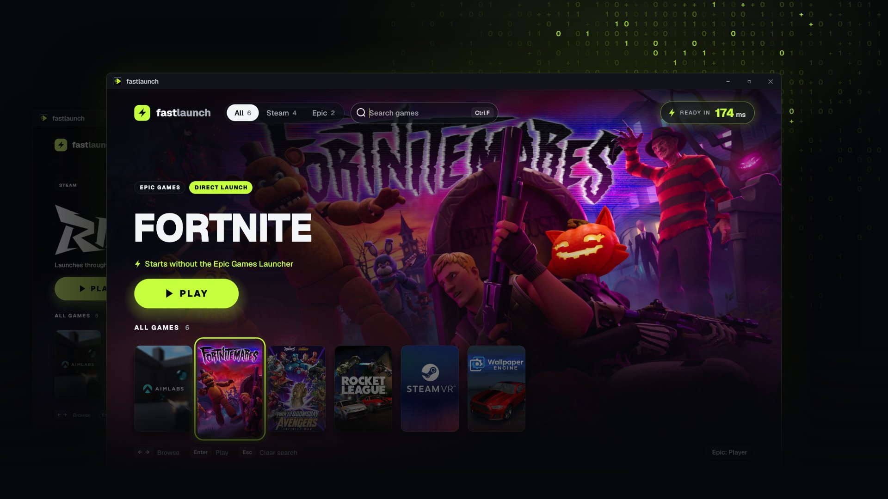
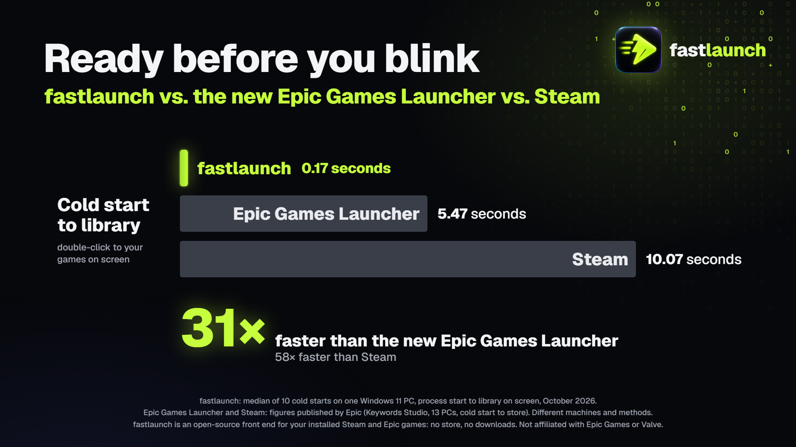
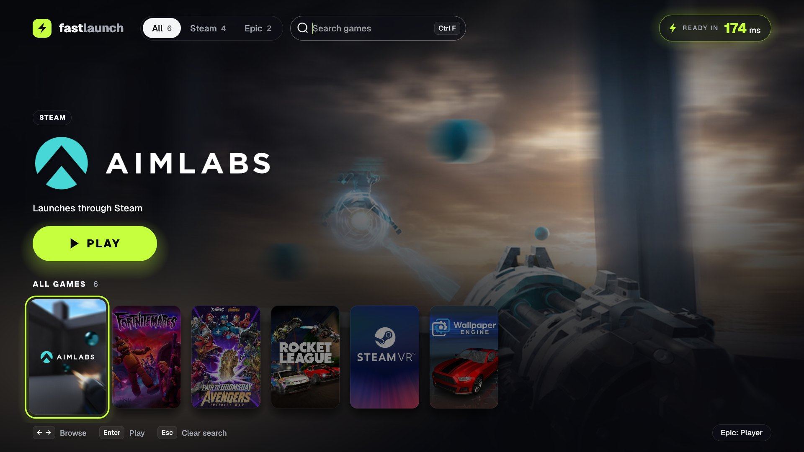

<p align="center">
  
</p>

<h1 align="center">fastlaunch</h1>

<p align="center">
  <b>A game launcher that opens in 0.17 seconds.</b><br>
  Your installed Steam and Epic games, one Play button, nothing else.
</p>

<p align="center">
  <a href="https://github.com/michal-marcinko/fastlaunch/releases/latest"></a>
  
  <a href="LICENSE"></a>
</p>

<p align="center">
  <a href="https://github.com/michal-marcinko/fastlaunch/releases/latest"><b>Download for Windows</b></a>
</p>

## Why this exists

Epic launched its new launcher with this:

> We vibe coded the Epic Games Launcher to be faster than the other guy.

It opens in 5.47 seconds. So we vibe coded one too.

<p align="center">
  
</p>

> [!NOTE]
> This isn't a fair fight. Epic's launcher has a store, downloads and a friends list. fastlaunch only finds the games you've installed and starts them. That's the whole job, and it turns out the job doesn't take five seconds.

## Features

- **Finds your games automatically.** It reads the Steam and Epic library files already on your PC.
- **Skips the Epic Games Launcher.** Sign in once, and Play starts the game directly.
- **Gets Steam ready early.** It starts Steam hidden in the tray, so it's ready by the time you press Play.
- **Keyboard first.** Arrows to browse, Enter to play, type to search, Esc to clear.
- **Zero CPU when idle.** It only redraws when something on screen changes.

<p align="center">
  
</p>

## What it won't do

- **Sell you anything.**
- **Open on a store.** Epic's benchmark times how long its launcher takes to show you the *store*. Ours times how long fastlaunch takes to show you *your games*. We think that's the one you wanted.
- **Download or update games.** Install them with Steam or Epic, and fastlaunch picks them up.
- **Run on Mac or Linux.** Epic's new launcher does Linux. Point to Epic.

## Quick start

1. Download `fastlaunch.exe` from [Releases](https://github.com/michal-marcinko/fastlaunch/releases/latest) and run it. There's no installer.
2. Optional: click **Sign in to Epic** so Epic games start without the Epic Games Launcher.
3. Pick a game and press **Play**.

> [!WARNING]
> The .exe isn't code-signed yet, so Windows SmartScreen warns you on first run. Click **More info**, then **Run anyway**, or [build it yourself](#build-from-source).

## Benchmarks

| Launcher | Cold start | Source |
|---|---:|---|
| **fastlaunch** | **0.17 s** | Median of 10 runs on one Windows 11 PC |
| Epic Games Launcher (new) | 5.47 s | Epic's published figure |
| Steam | 10.07 s | Epic's published figure |

These numbers come from different PCs and different tests, and Epic's figures time the launch until the store appears. Treat the chart as a joke built on real numbers, not a lab result.

<details>
<summary><b>Time it on your own PC</b></summary>

<br>

```powershell
$env:FASTLAUNCH_BENCH = "$env:TEMP\fastlaunch-ms.txt"
.\fastlaunch.exe   # opens, waits for your library, saves the time in ms, then quits
Get-Content $env:TEMP\fastlaunch-ms.txt
```

About 150 ms of the startup is Windows creating an OpenGL context before fastlaunch can draw anything. The library loads on other threads during that wait. Link-time optimisation and preloading DLLs didn't make it any faster, so the graphics driver is now the bottleneck.

</details>

## How it works

<details>
<summary><b>Epic games, without the Epic Games Launcher</b></summary>

<br>

An Epic game doesn't need the launcher. It needs proof that you own it, and the launcher just passes that proof along. fastlaunch does the same:

1. You sign in once on Epic's website. The saved sign-in goes into Windows Credential Manager, not a file.
2. When you press Play, fastlaunch swaps it for a one-time code from Epic.
3. It starts the game's .exe with that code and the same arguments the Epic launcher would use.

If the direct start fails, the game opens through the Epic Games Launcher instead.

This is a Rust port of part of [Legendary](https://github.com/legendary-gl/legendary), the open-source Epic client that worked all of this out years ago.

</details>

<details>
<summary><b>Why Steam games still need Steam</b></summary>

<br>

Steam games talk to the Steam app running on your PC through `steam_api.dll`. Without it, most of them quit or restart themselves through Steam. The only way around that is faking the Steam client, which is a cracking tool, not a launcher feature.

So fastlaunch starts Steam in the background as soon as it opens. Steam's 10-second startup happens while you're still picking a game.

</details>

## Build from source

You need Windows 10 or 11 and [Rust](https://rustup.rs) 1.95 or newer.

```powershell
git clone https://github.com/michal-marcinko/fastlaunch
cd fastlaunch
cargo build --release
```

The result is `target\release\fastlaunch.exe`, one 11 MB file. It's built with [egui](https://github.com/emilk/egui) on OpenGL, which starts about 2.5× faster than egui's default graphics backend (wgpu) on Windows.

| Environment variable | What it does |
|---|---|
| `FASTLAUNCH_BENCH=<file>` | Saves the startup time in ms to `<file>`, then quits |
| `FASTLAUNCH_NO_STEAM_PREWARM=1` | Stops fastlaunch from starting Steam in the background |

## FAQ

**Was this vibe coded?**
Yes, with [Claude Code](https://claude.com/claude-code). Vibe coding was never the slow part. Everything that ships alongside it is.

**Is it really 31× faster than the Epic Games Launcher?**
On the chart, yes. In a fair test, we don't know. It is ready before you let go of the mouse button.

**Can this get my Epic account banned?**
It signs in and launches games the same way Legendary has for years. It's still unofficial and Epic can change the rules, so use it at your own risk.

**Does it work with anti-cheat games?**
Rocket League starts directly. Some anti-cheat may insist on the Epic launcher. If the direct start fails, fastlaunch opens the game through the launcher instead.

**Why no store?**
Have you seen how long stores take to load?

## License

[GPL-3.0](LICENSE). The Epic launch code is ported from Legendary (GPL-3.0). The Geist font is under the [SIL Open Font License](assets/Geist-OFL.txt).

<sub>fastlaunch is not affiliated with or endorsed by Epic Games or Valve. Epic Games and Fortnite are trademarks of Epic Games, Inc. Steam is a trademark of Valve Corporation. Game art belongs to its owners.</sub>
